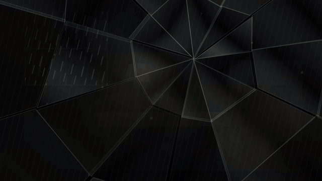
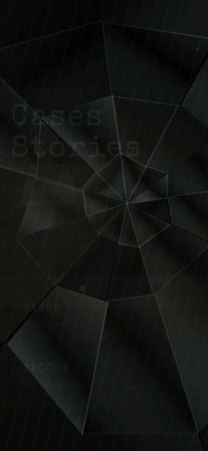

# Cases Stories

Jogo de investigação em React + TypeScript + Vite. Cada história é um **Caso** (dossiê) com cenas, suspeitos, evidências e acusação final.

Casos disponíveis: **001 · O Caso Valverde**, **002 · O Caso Imperial** e **003 · O Caso Aurora** (uma vinícola na noite da colheita).





Menu principal: **Continuar** (retoma o último caso), **Casos** (arquivo de dossiês) e **Opções** (som, gráficos e jogo, salvas em `localStorage`). Visual em neomorfismo, com espelho quebrado ao fundo.

## Responsivo

Feito mobile-first e testado em 320px, 390px (celular), 844x390 (celular deitado), 768px (tablet) e 1280-1440px (PC).

- **Celular e tablet em retrato:** coluna única, barra de abas embaixo, alvos de toque maiores em telas de toque.
- **PC (a partir de 900px) e celular deitado:** a cena ocupa a área principal com a lista de cômodos ao lado, o interrogatório vira duas colunas (perguntas e respostas), o quadro e a acusação viram grade, a folha de evidência abre como janela central e as abas ficam centralizadas.
- **Mouse:** realces de hover só em dispositivos com hover (`@media (hover:hover)`).
- As regras ficam no fim de `src/styles.css`, na seção "Responsivo". As telas usam os wrappers `.sc-tab`, `.dlg`, `.cols`, `.notes` e `.acc3` de `App.tsx`.
- As fontes (Special Elite e Newsreader) vêm do pacote `@fontsource`, então o jogo funciona offline e sem depender do Google Fonts.

## Rodar

```bash
npm install
npm run dev      # desenvolvimento
npm run build    # checa tipos e gera dist/
npm run preview  # testa o build
```

## Estrutura

- `src/types.ts`: tipos do jogo, incluindo a interface `Case`
- `src/cases/`: um arquivo por caso (`valverde.ts`, `imperial.ts`, `aurora.ts`) e `index.ts` com a lista `CASES`
- `src/MainMenu.tsx`: menu principal (Continuar, Casos, Opções) e o fundo de espelho quebrado
- `src/settings.ts` e `src/audio.ts`: opções de som e gráficos (chuva ambiente e efeitos gerados por WebAudio, sem arquivos)
- `src/state.ts`: estado do jogo (`useReducer`) e persistência em `localStorage` (uma chave por caso; o Valverde mantém `caso-valverde-v1`, então saves antigos continuam valendo)
- `src/svg.ts`: desenho das cenas, personagens e cutscenes de todos os casos (strings SVG)
- `src/Scene.tsx`: componentes de cena (com pontos de investigação)
- `src/App.tsx`: telas (menu, cutscene, abas, folha de evidência)
- `src/styles.css`: estilos

## Deploy (Vercel)

Importe o repositório; o preset Vite é detectado sozinho (build `npm run build`, saída `dist`).

## Como criar um novo caso

1. Copie `src/cases/imperial.ts` e ajuste suspeitos, 8 evidências, 4 cenas (com os pontos `h`), métodos, motivos e `win`.
2. Registre o caso em `src/cases/index.ts` (`CASES`).
3. Em `src/svg.ts`: adicione o cenário de cada cena em `scenery()`, as luzes em `LT`, os personagens em `PP` e as cutscenes em `CUTS`.
4. Se quiser uma paleta própria, crie um bloco `:root[data-case="<tema>"]` em `styles.css` (veja o `imperial`).

## Identidade visual

- `public/logo-emblem.svg`: emblema (lupa com lente de espelho quebrado e fechadura)
- `public/logo.svg`: logotipo com nome, subtítulo e reflexo (usa a fonte Special Elite)
- `public/favicon.svg` e `public/logo-emblem-1024.png`: favicon e ícone
- `docs/demo-pc.gif` e `docs/demo-mobile.gif`: demonstração do jogo no PC e no celular
- `src/Logo.tsx` e `src/emblem.ts`: o emblema usado no menu principal
